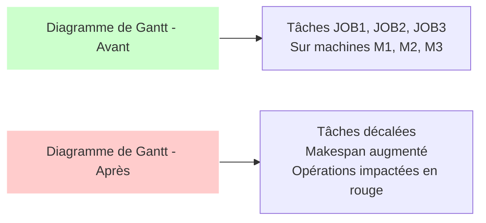

# 🏭 Assistant de planification Supply Chain

Un système d'optimisation de la planification de production basé sur l'IA agentique qui simule des perturbations (pannes de machines, retards de composants) et compare les plannings avant/après perturbation en utilisant OR-Tools pour la résolution du problème d'ordonnancement job shop.

## 📋 Fonctionnalités principales

- **Interface chatbot interactive** (Streamlit) pour décrire les perturbations en langage naturel
- **Système multi-agents** basé sur LangGraph pour analyser, valider, planifier, évaluer et expliquer les scénarios
- **Optimisation mathématique** avec OR-Tools pour résoudre les problèmes d'ordonnancement job shop
- **Comparaison before/after** des plannings avec visualisations Gantt interactives
- **Support multi-LLM** (Groq, Hugging Face) avec fallback vers des règles basées
- **Visualisations interactives** avec Plotly pour analyser l'impact des perturbations
- **Gestion des composants** et de leurs disponibilités pour des scénarios de retard réalistes

## 🏗️ Architecture du système

```mermaid
graph TD
    A[Interface Utilisateur<br/>Streamlit] --> B[Workflow Principal<br/>LangGraph]
    B --> C1[Agent Analyseur de Problème]
    B --> C2[Agent de Validation]
    B --> C3[Agent de Planification]
    B --> C4[Agent d'Évaluation]
    B --> C5[Agent d'Explication]
    
    C1 --> D[Extraction des Données<br/>LLM ou Rules-based]
    C2 --> E[Validation Pydantic]
    C3 --> F[OR-Tools Solver]
    C4 --> G[Métriques de Qualité]
    C5 --> H[Génération d'Explications]
    
    D --> E
    E --> F
    F --> G
    G --> H
    H --> A
    
    style A fill:#f9f,stroke:#FFF,color=#000000
    style B fill:#bbf,stroke:#FFF,color=#000000
    style C1 fill:#dfd,stroke:#FFF,color=#000000
    style C2 fill:#dfd,stroke:#FFF,color=#000000
    style C3 fill:#dfd,stroke:#FFF,color=#000000
    style C4 fill:#dfd,stroke:#FFF,color=#000000
    style C5 fill:#dfd,stroke:#FFF,color=#000000
    style D fill:#ffd,stroke:#FFF,color=#000000
    style E fill:#ffd,stroke:#FFF,color=#000000
    style F fill:#ffd,stroke:#FFF,color=#000000
    style G fill:#ffd,stroke:#FFF,color=#000000
    style H fill:#ffd,stroke:#FFF,color=#000000
```

### Flux de traitement détaillé

1. **Interface Utilisateur** : L'utilisateur décrit une perturbation via le chatbot Streamlit
2. **Analyse du problème** : L'agent analyseur extrait les données structurées (jobs, machines, opérations) soit via LLM soit via règles
3. **Validation** : Les données extraites sont validées avec les modèles Pydantic
4. **Application des perturbations** : Les scénarios de panne/retard sont appliqués au modèle de problème
5. **Planification** : OR-Tools résout les problèmes d'ordonnancement job shop pour les scénarios de référence et perturbés
6. **Évaluation** : La qualité des solutions est évaluée (makespan, tardiness, etc.)
7. **Explication** : Un explicateur génère une analyse en langage naturel des résultats
8. **Affichage** : Les résultats sont affichés avec des métriques, des tableaux de comparaison et des diagrammes de Gantt

## 🧩 Composants techniques

### Modules principaux

- `app.py` : Interface Streamlit principale
- `src/models/supply_chain.py` : Modèles Pydantic pour les données du problème
- `src/workflow/supply_chain_workflow.py` : Workflow LangGraph orchestrant les agents
- `src/agents/` : Tous les agents spécialisés (analyse, validation, planification, évaluation, explication)
- `src/utils/` : Fonctions utilitaires (chargement de données, perturbations, impact, LLM, rapport)

### Technologies utilisées

- **Streamlit** : Interface web interactive
- **LangGraph** : Orchestration du workflow multi-agents
- **OR-Tools** : Solveur d'optimisation pour les problèmes d'ordonnancement
- **LangChain** : Intégration avec les LLMs (Groq, Hugging Face)
- **Pydantic** : Validation et sérialisation des données
- **Plotly** : Visualisations interactives de Gantt
- **Pandas** : Manipulation de données tabulaires
- **Python-dotenv** : Gestion des variables d'environnement

## 📊 Exemple de visualisation

Le système génère des diagrammes de Gantt interactifs montrant :

- **Avant perturbation** : Planning optimal sans perturbations
- **Après perturbation** : Planning recalculé avec les pannes/retards appliqués
- **Impact visualisé** : Décalages des opérations, augmentation du makespan



## 🚀 Installation et utilisation

### Prérequis

- Python 3.8+
- Clé API Groq (recommandé) ou token Hugging Face

### Installation

```bash
# Cloner le dépôt
git clone <repository-url>
cd SupplyChain

# Créer un environnement virtuel
python -m venv .venv
source .venv/bin/activate  # Linux/Mac
.\.venv\Scripts\activate   # Windows

# Installer les dépendances
pip install -r requirements.txt

# Configurer les variables d'environnement
cp .env.example .env
# Éditer .env pour ajouter votre GROQ_API_KEY ou HF_TOKEN
```

### Utilisation

```bash
# Lancer l'application
streamlit run app.py
```

Puis dans l'interface web :
1. Configurer votre clé API dans la barre latérale (ou laisser vide pour le mode règles-only)
2. Charger un fichier de données JSON/CSV ou utiliser l'exemple fourni
3. Décrire une perturbation en langage naturel (ex: "panne de M2 pendant les deux premières heures")
4. Visualiser les résultats avec les diagrammes de Gantt et les métriques comparatives

## 📁 Structure du projet

```
SupplyChain/
├── app.py                     # Application Streamlit principale
├── requirements.txt           # Dépendances Python
├── sample_jobs.csv           # Exemple de données au format CSV
├── LICENSE                   # Licence MIT
├── .env.example              # Template de configuration environnement
├── .gitignore                # Fichiers à ignorer par Git
├── src/
│   ├── __init__.py
│   ├── agents/               # Tous les agents spécialisés
│   │   ├── chat_agent.py
│   │   ├── evaluation_agent.py
│   │   ├── explanation_agent.py
│   │   ├── planning_agent.py
│   │   ├── problem_analyzer.py
│   │   └── validation_agent.py
│   ├── models/               # Modèles de données Pydantic
│   │   └── supply_chain.py
│   ├── utils/                # Fonctions utilitaires
│   │   ├── __init__.py
│   │   ├── data_loader.py
│   │   ├── disruptions.py
│   │   ├── impact.py
│   │   ├── llm.py
│   │   ├── report.py
│   │   └── sample_data.py
│   └── workflow/             # Workflow LangGraph
│       └── supply_chain_workflow.py
└── tests/                    # Tests unitaires
    ├── __init__.py
    └── test_placeholder.py
```

## 🔧 Configuration

Le fichier `.env` permet de configurer :
- `GROQ_API_KEY` : Clé API pour les modèles Groq (recommandé)
- `HF_TOKEN` : Token pour les modèles Hugging Face
- Autres paramètres éventuels selon les besoins

## 📈 Métriques évaluées

Le système calcule et compare plusieurs métriques entre les scénarios de référence et perturbés :
- **Makespan** : Temps total de completion
- **Tardiness** : Retard moyen des jobs
- **Utilisation des machines** : Pourcentage de temps utilisé
- **Nombre d'opérations décalées** : Opérations dont l'horaire a changé

## 🤝 Contribution

Les contributions sont les bienvenues ! N'hésitez pas à :
1. Fork le projet
2. Créer une branche pour votre fonctionnalité
3. Commiter vos changements
4. Ouvrir une Pull Request

## 📄 Licence

Ce projet est sous licence MIT - voir le fichier `LICENSE` pour plus de détails.

---

*Assistant de planification Supply Chain - Optimisez votre production avec l'IA agentique*
